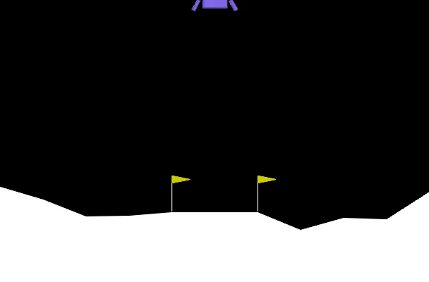

# Deep Q-Learning Lunar Lander: From Zero to Autonomous Landing

An end-to-end reinforcement learning project that trains a **Deep Q-Network (DQN)** agent to master the Gymnasium `LunarLander-v3` environment from scratch, featuring production-optimized memory management and comprehensive multi-dimensional visual analytics.

<!-- Centered Demo GIF Preview -->

  

---

## Key Engineering Highlights

* **Disk-Based Checkpointing Architecture:** Entirely eliminates Google Colab RAM crashes by serializing model weights directly to disk (`model_checkpoints/`) rather than hoarding tensors in working memory.
* **Multi-Milestone Video Showcase:** Automatically extracts disk weights to render high-resolution exploitation rollout videos across training quartiles (0%, 25%, 50%, 75%, and 100% success).
* **Trajectory Evolution Animation & Gallery:** Traces $(x, y)$ coordinates and landing tilt angles across checkpoints, compiling them into an animated GIF and a dynamic, base64-embedded HTML thumbnail grid.
* **Production Safety Guards:** Implements strict step-limit safety counters (`max_eval_steps = 1000`) and non-interactive Matplotlib backends (`Agg`) to prevent infinite rollout evaluation hangs.

---

## The Environment: Gymnasium `LunarLander-v3`

Developed by the Farama Foundation, [Gymnasium](https://gymnasium.farama.org/) provides standardized RL environments. The goal of `LunarLander-v3` is to safely guide a landing craft onto a designated pad between $x = -0.2$ and $x = 0.2$ at $(0,0)$.

* **State Space (8 Continuous Variables):** $(x, y)$ coordinates, linear velocities $(v_x, v_y)$, lander angle $\theta$, angular velocity $\omega$, and two boolean ground-contact leg flags.
* **Action Space (4 Discrete Actions):** Do nothing (`0`), fire left orientation engine (`1`), fire main vertical thruster (`2`), and fire right orientation engine (`3`).
* **Success Criterion ($\ge 200.0$):** Officially solved when the running average score of the last 100 episodes reaches or exceeds **200.0**[cite: 36].

---

## Core Technical Concepts & Architecture

### 1. Artificial Neural Network (ANN)
A 3-layer fully connected network maps raw 8-dimensional states to expected Q-values for all 4 actions, utilizing **ReLU** activation functions across 64-neuron hidden layers to capture non-linear flight physics.

### 2. Experience Replay Memory
To break sequential data correlations and stabilize gradient descent, past experiences $(s, a, r, s', \text{done})$ are stored in a buffer ($N = 100,000$) and sampled randomly in minibatches ($N = 150$).

### 3. Target Networks & Soft Updates
To prevent training oscillations caused by moving targets, we decouple networks into a rapidly updated **Local Network** ($Q_{local}$) and a stable **Target Network** ($Q_{target}$), updated slowly via soft interpolation ($\tau = 0.001$).

### 4. The Bellman Optimality Equation
The agent minimizes Mean Squared Error (MSE) loss against target values derived from the Bellman equation:
$$Q_{target}(s, a) = r + \gamma \max_{a'} Q_{target}(s', a')$$
*(where discount factor $\gamma = 0.99$ prioritizes long-term landing stability over immediate rewards).*

### 5. Exploration-Exploitation Tradeoff ($\epsilon$-Greedy)
The agent balances exploration and exploitation using an $\epsilon$-greedy policy where $\epsilon$ decays exponentially from `1.0` down to `0.01` (`0.995` decay rate), transitioning the agent from curious explorer to precise pilot[cite: 36].

---

## Training Results & Performance Summary

* **Total Episodes to Solve:** 689 episodes[cite: 38]
* **Final Exploration Rate ($\epsilon$):** 0.032[cite: 38]
* **Final Performance:** Consistent positive scoring exceeding the +200 threshold, proving robust landing mastery.

---

## Tech Stack
* **Language:** Python 3.13
* **Deep Learning Framework:** PyTorch (`torch.nn`, `torch.optim`)
* **RL Environment:** Gymnasium (`box2d`)
* **Data & Visualization:** NumPy, Matplotlib, ImageIO, IPython HTML

---
